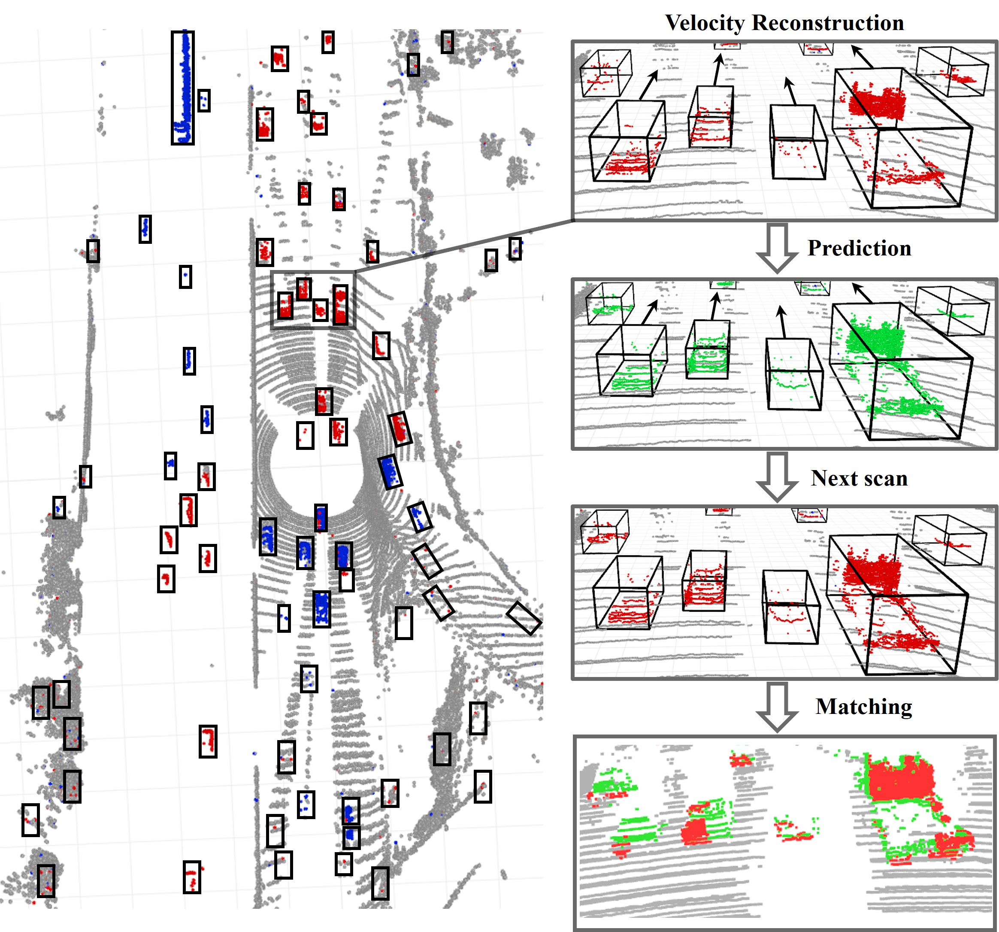
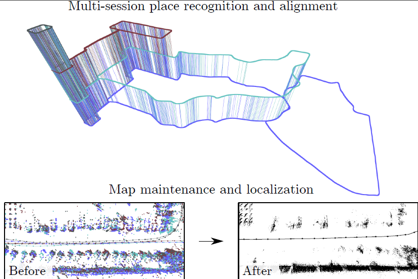
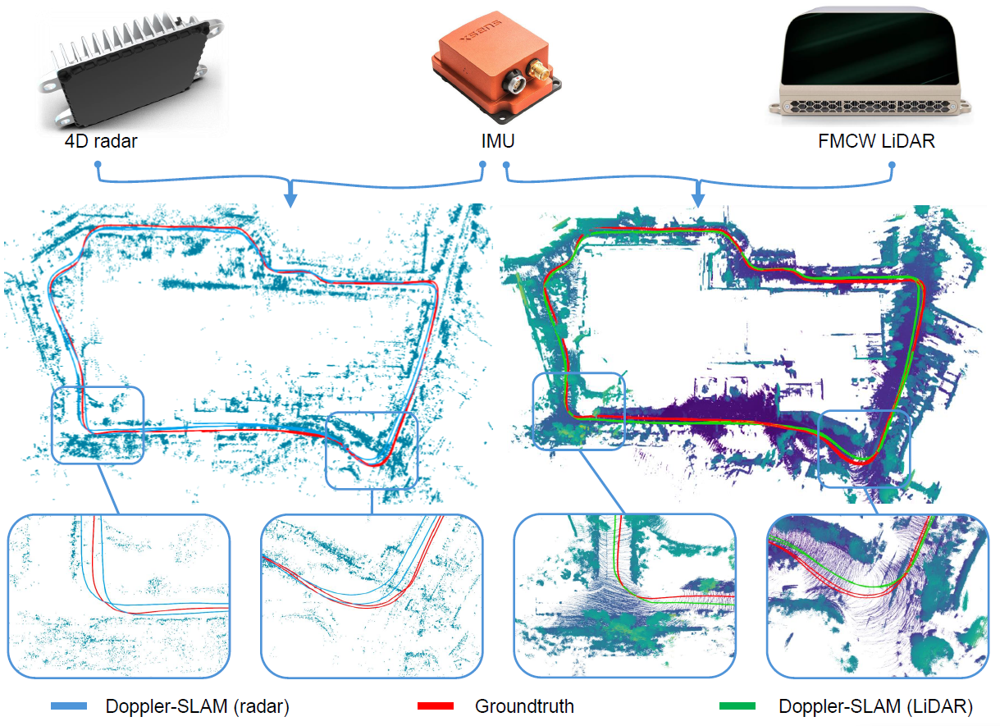
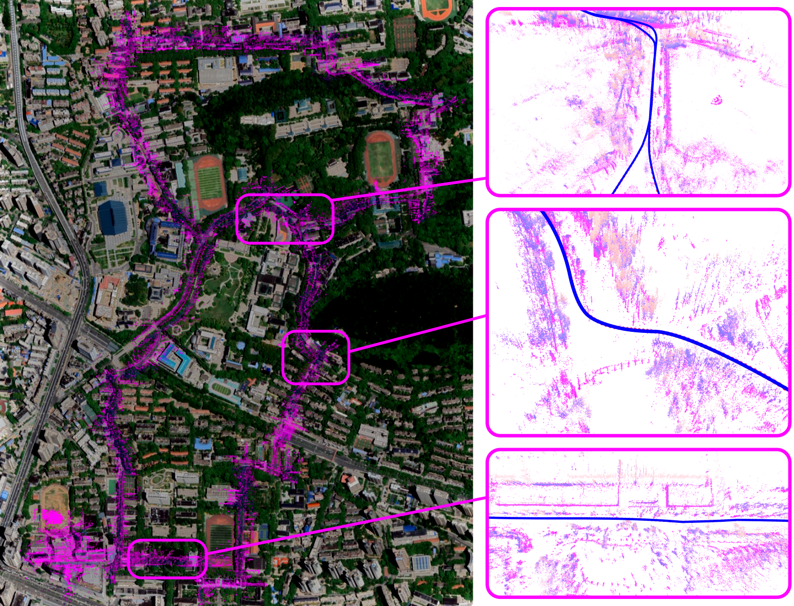

Hi — I’m **Dong Wang (王东)**, a robotics researcher at **Julius-Maximilians-Universität Würzburg (JMU)** and co-founder of [**Harsher**](https://www.harsher.de). My research focuses on **SLAM and Spatial AI**, with an emphasis on **Doppler-aided localization, 4D radar, and multimodal perception** for reliable autonomy in harsh and dynamic environments.

I completed my **Ph.D. in Robotics at JMU in July 2026**, graduating with **summa cum laude**. My dissertation, *Doppler-Aided Localization and Mapping for Autonomous Systems*, was supervised by [Prof. Dr. Andreas Nüchter](https://www.informatik.uni-wuerzburg.de/robotics/team/nuechter/) and [Prof. Dr. Stefan May](https://www.th-nuernberg.de/person/may-stefan/).

I hold an **M.Sc. in Robotics** from Friedrich-Alexander-Universität Erlangen-Nürnberg, where I devised a 3D pathplanning framework for multi-UAV systems, and a joint **B.Sc.and B.Eng. in Mechatronics** from Tongji University and the Nuremberg Institute of Technology.

My research and engineering experience includes:

* working as a **Research Associate** at JMU and supervising undergraduate thesis projects,
* leading the **AutonOhm** software team, winners at the RoboCup German Open Rescue 2021 and 2022 and 4th place in Industrial @ Work 2023,
* working as a **Software Developer** at **Evocortex GmbH** from 2020 to 2024, delivering perception and autonomy stacks for next-generation AMRs and UAVs.

News
======
- **November 2026** — My project *Reliability-Aware Multimodal SLAM for Long-Term Autonomy in Harsh Environments* has received approximately **€230,000 in DFG funding**. The two-year project starts on **January 1, 2027**, in collaboration with **Technische Hochschule Nürnberg Georg Simon Ohm**, and will investigate reliable robot navigation under challenging sensing conditions. [University press release](https://www.uni-wuerzburg.de/aktuelles/einblick/single/news/roboter-navigation/)

- **July 2026** — I successfully defended my doctoral dissertation, *Doppler-Aided Localization and Mapping for Autonomous Systems*, on **July 31**, graduating with **summa cum laude**. Many thanks to my supervisors and collaborators for their support throughout this journey. [JMU announcement](https://www.informatik.uni-wuerzburg.de/en/robotics/news/detail/news/dong-wang-successfully-completes-his-phd/)

- I am a co-founder of [**Harsher**](https://www.harsher.de), a startup developing radar-first perception, localization, and safety systems for heavy machinery and outdoor service robots operating in harsh environments.

- **April 2026** — Our paper *[Edge Radar Material Classification Under Geometry Shifts](https://arxiv.org/abs/2603.23342)* was accepted for presentation at the **ICRA 2026 Workshop on Long-term Deployments in the Wild (LoWi 2026)**, with **Jannik Hohmann** as the scheduled presenter.

- **February 2026** — *[Dynamic-ICP: Doppler-Aware Iterative Closest Point Registration for Dynamic Scenes](https://arxiv.org/abs/2511.20292)* was accepted to **IEEE Robotics and Automation Letters (RA-L)**. [Code](https://github.com/JMUWRobotics/Dynamic-ICP)

- **December 2025** — Our work *[Multi-Session Mapping and Long-Term Localization for Autonomous Vehicles Using Radar](https://ieeexplore.ieee.org/abstract/document/11346986)* was accepted to **IEEE Robotics and Automation Letters (RA-L)** and appears in the **2026** volume.

- **October 2025** — I received the **2025 BayWISS Prize** for outstanding or pioneering research achievements. [Announcement](https://www.baywiss.de/news-und-termine/news-detail/baywiss-preis-2025-fuer-eine-herausragende-oder-zukunftsweisende-forschungsleistung-im-jeweiligen-wissenschaftsbereich)

- **July 2025** — *[Doppler-SLAM](https://arxiv.org/abs/2504.11634)* was accepted to **IEEE Robotics and Automation Letters (RA-L)**.

- **March 2025** — *[RaI-SLAM](https://ieeexplore.ieee.org/abstract/document/10947322)* was accepted to **IEEE Robotics and Automation Letters (RA-L)**.

Recent Research
======
<table width="100%" align="center" border="0" cellspacing="0" cellpadding="20" >
    <tr onmouseout="nice_stop()" onmouseover="nice_start()">  
      <td width="25%">
        
 
    </td>
      <td valign="top" width="75%">
            <papertitle>
              <a href="https://github.com/JMUWRobotics/Dynamic-ICP"><strong>Dynamic-ICP: Doppler-Aware Iterative Closest Point Registration for
              Dynamic Scenes</strong></a>
            </papertitle>
       
          <strong>Dong Wang</strong>,
          Daniel Casado Herraez,
          <a href="https://www.th-nuernberg.de/person/may-stefan/">Stefan May</a>,
          <a href="https://www.informatik.uni-wuerzburg.de/space/mitarbeiter/nuechter/">Andreas Nuchter</a>
       
          <em>IEEE Robotics and Automation Letters (<strong>RA-L</strong>)</em>, 2026
       
        <a href="https://arxiv.org/abs/2511.20292">paper</a> |
        <a href="https://github.com/JMUWRobotics/Dynamic-ICP">website</a> |
        <a href="https://github.com/JMUWRobotics/Dynamic-ICP">code</a> |
        <a href="https://robotik.informatik.uni-wuerzburg.de/telematics/3dscans/">dataset</a>
        

        We introduce Dynamic-ICP, a Doppler-aware registration framework. The method (i) estimates ego motion from per-point Doppler velocity via robust regression and builds a velocity filter, (ii) clusters dynamic objects and reconstructs object-wise translational velocities from ego-compensated radial measurements, (iii) predicts dynamic points with a constant-velocity model, and (iv) aligns scans using a compact objective that combines point-to-plane geometry residual with a translation-invariant, rotation-only Doppler residual.
        

      </td>
    </tr>
</table> 
<table width="100%" align="center" border="0" cellspacing="0" cellpadding="20" >
    <tr onmouseout="nice_stop()" onmouseover="nice_start()">  
      <td width="25%">
        
 
    </td>
      <td valign="top" width="75%">
            <papertitle>
              <a href="https://github.com/PRBonn/RaI-SLAM"><strong>Multi-Session Mapping and Long-Term Localization for Autonomous Vehicles Using Radar</strong></a>
            </papertitle>
       
          Daniel Casado Herraez, Matthias Zeller, 
          <strong>Dong Wang</strong>,
          Jens Behley, Michael Heidingsfeld,
          <a href="https://www.ipb.uni-bonn.de/people/cyrill-stachniss/index.html">Cyrill Stachniss</a>
       
          <em>IEEE Robotics and Automation Letters (<strong>RA-L</strong>)</em>, 2026
       
        <a href="https://ieeexplore.ieee.org/abstract/document/11346986">paper</a> |
        

          In our approach, we construct
          maps of coinciding areas and align them by performing place recognition
          between them. Additionally, our multi-sequence loop detection and
          verification strategy for radar sensors is able to filter incorrect
          loop matches enhancing trajectory alignment. Then, our novel map
          maintenance module handles radar noise and preserves persistent map
          points that remain reliable for localization. Subsequently, we estimate
          the robot poses in the resulting map by combining local odometry with
          scan-to-map matching, overcoming the complexities of sparse automotive
          radar data.
        

      </td>
    </tr>
</table> 
<table width="100%" align="center" border="0" cellspacing="0" cellpadding="20" >
    <tr onmouseout="nice_stop()" onmouseover="nice_start()">  
      <td width="25%">
        
 
    </td>
      <td valign="top" width="75%">
            <papertitle>
              <a href="https://github.com/Wayne-DWA/Doppler-SLAM"><strong>Doppler-SLAM: Doppler-Aided Radar-Inertial and LiDAR-Inertial Simultaneous Localization and Mapping</strong></a>
            </papertitle>
       
          <strong>Dong Wang</strong>,
          Hannes Haag,
          Daniel Casado Herraez,
          <a href="https://www.th-nuernberg.de/person/may-stefan/">Stefan May</a>,
          <a href="https://www.ipb.uni-bonn.de/people/cyrill-stachniss/index.html">Cyrill Stachniss</a>,
          <a href="https://www.informatik.uni-wuerzburg.de/space/mitarbeiter/nuechter/">Andreas Nuchter</a>
       
          <em>IEEE Robotics and Automation Letters (<strong>RA-L</strong>)</em>, 2025
       
        <a href="https://arxiv.org/pdf/2504.11634">paper</a> |
        <a href="https://github.com/Wayne-DWA/Doppler-SLAM">website</a> |
        <a href="https://github.com/Wayne-DWA/Doppler-SLAM">code</a> |
        <a href="https://robotik.informatik.uni-wuerzburg.de/telematics/3dscans/">dataset</a>
        

        We propose a novel Doppler-aided radar-inertial and LiDAR-inertial SLAM framework that leverages the complementary strengths of 4D radar, FMCW LiDAR, and inertial measurement units.
        

      </td>
    </tr>
</table> 
<table width="100%" align="center" border="0" cellspacing="0" cellpadding="20" >
    <tr onmouseout="nice_stop()" onmouseover="nice_start()">  
      <td width="25%">
        
 
    </td>
      <td valign="top" width="75%">
            <papertitle>
              <a href="https://github.com/PRBonn/RaI-SLAM"><strong>RaI-SLAM: Radar-Inertial SLAM for Autonomous Vehicles</strong></a>
            </papertitle>
       
          Daniel Casado Herraez, Matthias Zeller, 
          <strong>Dong Wang</strong>,
          Jens Behley, Michael Heidingsfeld,
          <a href="https://www.ipb.uni-bonn.de/people/cyrill-stachniss/index.html">Cyrill Stachniss</a>
       
          <em>IEEE Robotics and Automation Letters (<strong>RA-L</strong>)</em>, 2025
       
        <a href="https://ieeexplore.ieee.org/abstract/document/10947322">paper</a> |
        <a href="https://github.com/PRBonn/RaI-SLAM">code</a>
        

        We propose a modular approach that performs radar-inertial SLAM by fully leveraging the characteristics of automotive consumer-vehicle radar sensors.
        

      </td>
    </tr>
</table>
